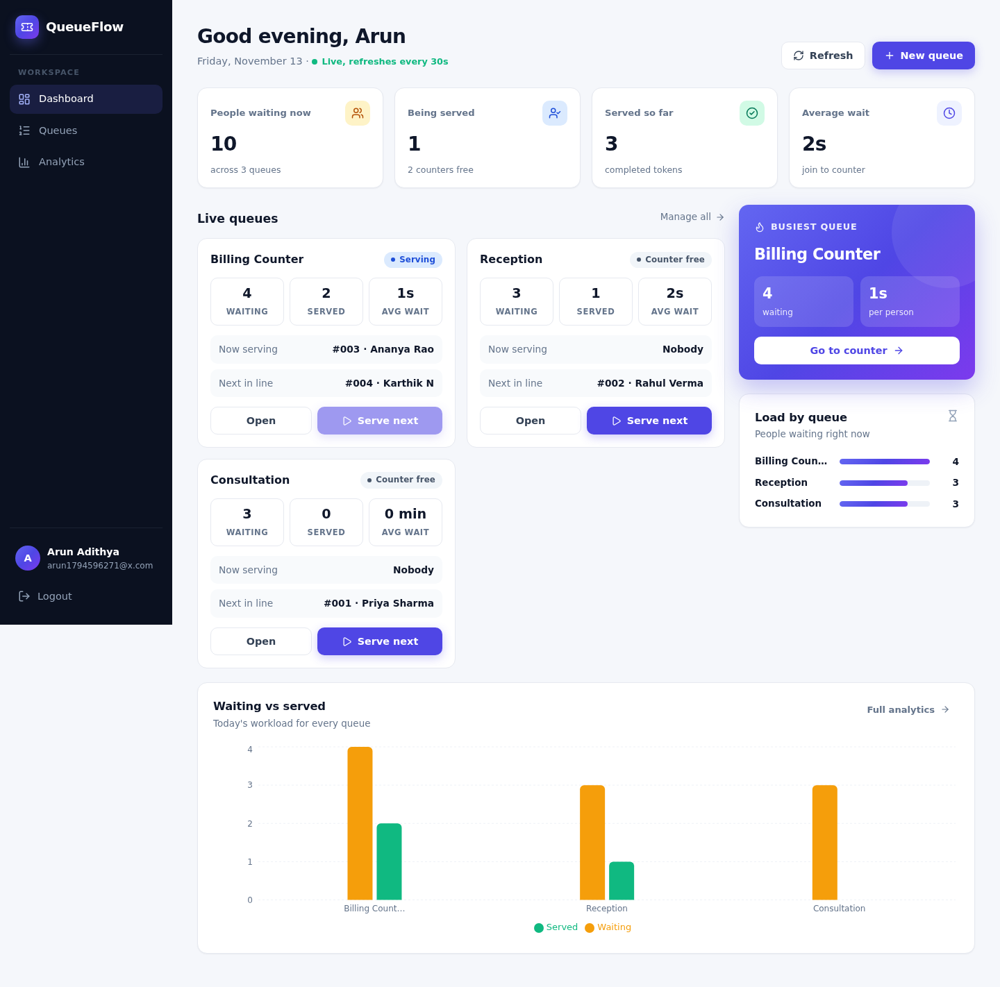
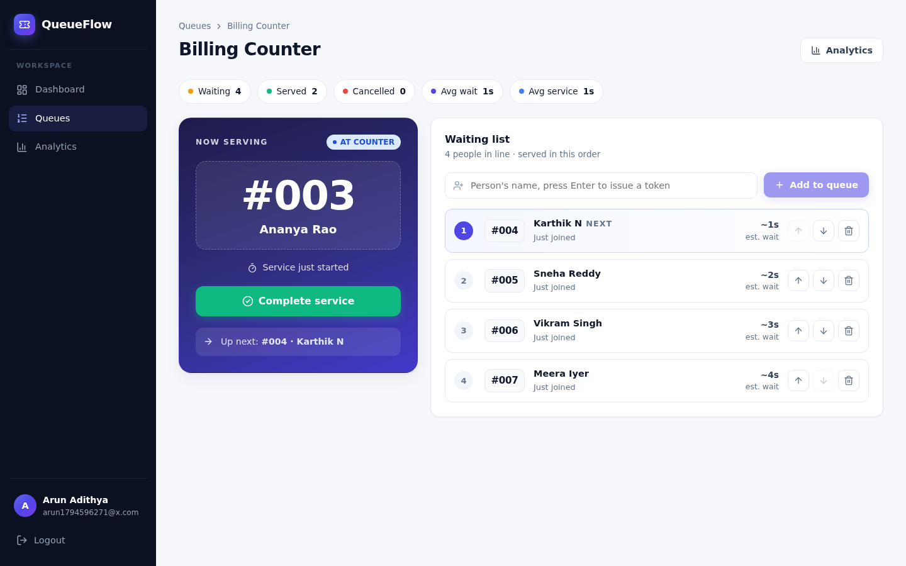
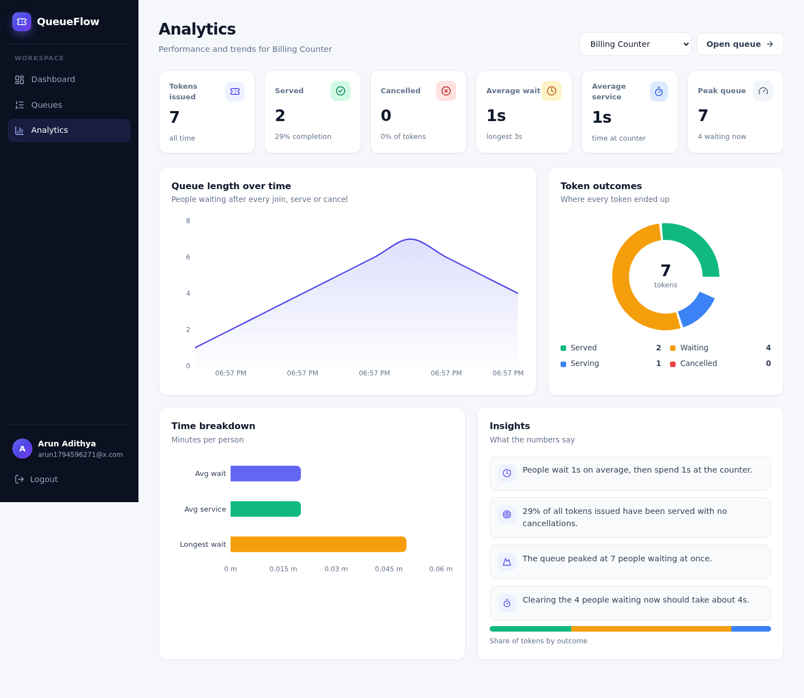
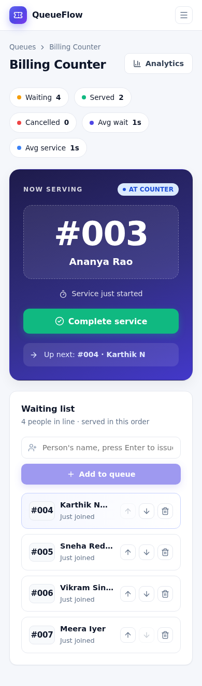

# Queue Management System

A full-stack queue management app. A queue manager signs in, creates named queues, issues tokens to people, reorders and cancels them, serves the person at the top with one click, and tracks wait times and queue-length trends on an analytics dashboard.

## Features

1. Manager registration and login (JWT)
2. Create named queues (each manager sees only their own)
3. Add a person to a queue – a token number is generated automatically
4. Live waiting list in queue order
5. Move tokens up and down
6. "Serve next" assigns the token at the top of the queue in one click, then "Complete service"
7. Cancel a token (with confirmation)
8. Dashboard and analytics: average and longest wait, average service time, served and cancelled counts, queue-length trend chart

## Tech stack

| Layer | Technology |
|---|---|
| Backend | Java 21, Spring Boot 4, Spring Security, Spring Data JPA, JWT (jjwt) |
| Database | MySQL 8 |
| Frontend | React 19, Vite, React Router, Axios, Recharts, Lucide icons |

## Project structure

```
Queue_backend/    Spring Boot REST API (port 4887)
queue_frontend/   React client (port 9642)
```

## Running locally

### Prerequisites
- Java 21
- Node.js 20+
- MySQL 8 running on localhost:3306 (default login `root` / `root`)

### Backend
```bash
cd Queue_backend
./mvnw spring-boot:run          # Windows: mvnw.cmd spring-boot:run
```
The `queue_db` database and its tables are created automatically on first run.

Optional environment variables:

| Variable | Default | Purpose |
|---|---|---|
| `DB_URL` | `jdbc:mysql://localhost:3306/queue_db?createDatabaseIfNotExist=true` | Database URL |
| `DB_USERNAME` / `DB_PASSWORD` | `root` / `root` | Database login |
| `JWT_SECRET` | random per run | Signing key for login tokens (32+ characters). If unset, a random key is generated at startup, so logins reset when the server restarts. There is no built-in default secret. |
| `CORS_ALLOWED_ORIGINS` | `http://localhost:*,http://127.0.0.1:*` | Origins allowed to call the API |

Set one in bash with `export JWT_SECRET=...`, in PowerShell with `$env:JWT_SECRET="..."`.

### Frontend
```bash
cd queue_frontend
npm install
npm run dev
```
Open http://localhost:9642, register a manager account and start creating queues. The API URL defaults to `http://localhost:4887`; to change it, copy `.env.example` to `.env` and edit `VITE_API_BASE_URL`.

### Tests
```bash
cd Queue_backend
./mvnw test                     # Windows: mvnw.cmd test
```
37 tests, no MySQL needed (they use an in-memory H2 database):
- **Unit tests** for the queue rules: token numbering, move up/down and its edges, serve-next, complete, cancel and re-numbering, ownership (`TokenServiceImplTest`), the analytics maths (`AnalyticsMathTest`), registration and login (`AuthServiceImplTest`) and JWT signing (`JwtUtilTest`).
- **Integration tests** (`QueueFlowIntegrationTest`) run the real services and SQL: the full counter flow, one manager unable to see another's queue, 10 simultaneous adds that never repeat a token number, and 5 simultaneous serve-next clicks that call exactly one person.

## API

All endpoints except `/api/auth/**` need `Authorization: Bearer <token>`.

| Method | Endpoint | Description |
|---|---|---|
| POST | `/api/auth/register` | Register a manager |
| POST | `/api/auth/login` | Log in, returns JWT |
| POST | `/api/queues` | Create a queue |
| GET | `/api/queues` | List my queues |
| GET | `/api/queues/{queueId}` | One queue |
| GET | `/api/queues/overview` | Live status of all my queues in one call (used by the dashboard) |
| POST | `/api/queues/{queueId}/tokens` | Add a person (creates a token) |
| GET | `/api/queues/{queueId}/tokens` | Waiting and currently-serving tokens |
| PATCH | `/api/tokens/{tokenId}/move?direction=UP\|DOWN` | Move a token |
| POST | `/api/queues/{queueId}/serve-next` | Serve the token at the top |
| POST | `/api/tokens/{tokenId}/complete` | Finish serving a token |
| PATCH | `/api/tokens/{tokenId}/cancel` | Cancel a waiting token |
| GET | `/api/queues/{queueId}/analytics` | Wait-time stats and queue-length trend |

## UI highlights

- **Dashboard**: live overview of every queue (auto-refresh every 30s): people waiting, being served, served so far, average wait, now-serving and next-in-line per queue, one-click Serve next, busiest-queue spotlight, waiting vs served chart.
- **Queue counter screen**: big Now Serving ticket with live timer and Complete button, waiting list with estimated wait per person, move up/down, cancel with confirmation, quick add with Enter.
- **Analytics**: per-queue deep dive with tokens issued, served, cancelled, completion rate, average and longest wait, average service time, peak queue length, queue-length area chart, token outcome donut, time breakdown and auto-generated insights.
- Toast notifications, skeleton loaders, empty states and a fully responsive layout (desktop, tablet, mobile).

## Screenshots

| Dashboard | Queue counter |
| --- | --- |
|  |  |

| Analytics | Mobile |
| --- | --- |
|  |  |

## Design notes

- **Ordering:** each waiting token stores an integer `position`; moving swaps positions with the neighbour, cancelling shifts later tokens up, new tokens go after the last one.
- **Token states:** `WAITING → SERVING → SERVED`, or `WAITING → CANCELLED`. Only one token per queue can be SERVING at a time.
- **Wait time** = `servingStartedAt − createdAt`; **service time** = `completedAt − servingStartedAt`.
- **Queue-length trend** replays every join (+1) and leave (−1) event in time order.
- **Concurrency:** every change to a queue's tokens (add, move, serve, complete, cancel) first locks that queue's row with `SELECT ... FOR UPDATE`, so two clicks on the same queue run one after the other. A unique key on `(queue_id, token_number)` backs this up at the database level.
- **Token numbers** are `max(token_number) + 1` per queue and are never reused, even after cancellations.
- **Peak queue length** is computed on the server over the queue's full history.
- **Data isolation:** every queue, token and analytics request checks that the queue belongs to the logged-in manager. Another manager's queue returns 404, not 403, so its existence is not revealed.
- **Validation:** names are limited to 100 characters, passwords to 6–72 (BCrypt's limit), and emails are stored lowercase.
- **Errors:** validation and business-rule errors return 400 with a readable message, missing resources 404, wrong HTTP method 405, conflicting writes 409, expired or missing login 401 (the client then returns to the login page). Unexpected errors are logged on the server and return a generic 500.
